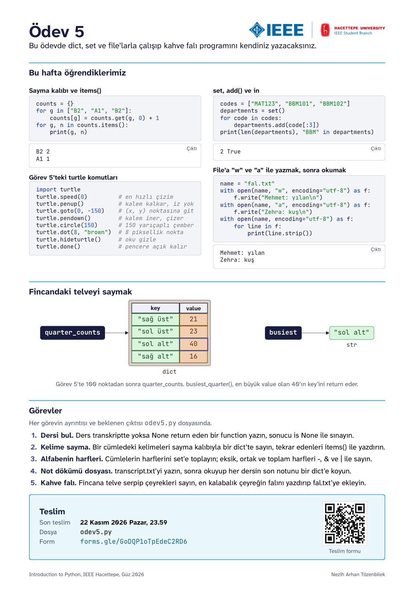
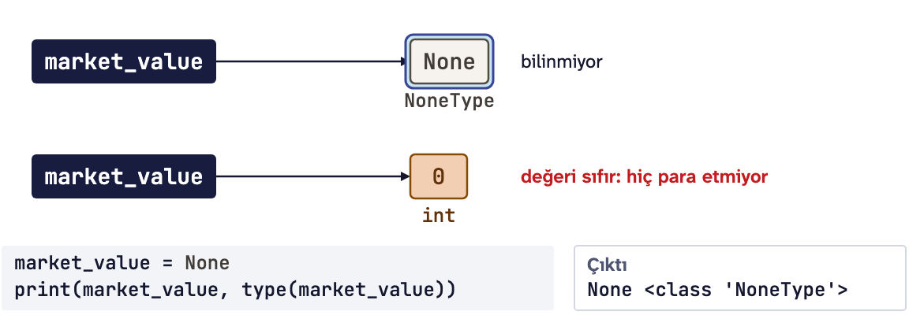
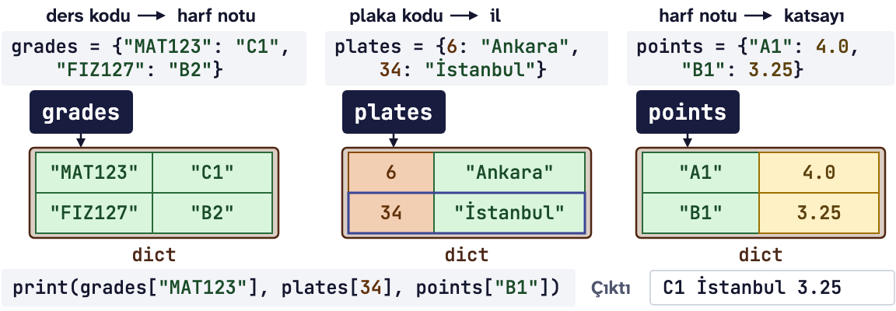
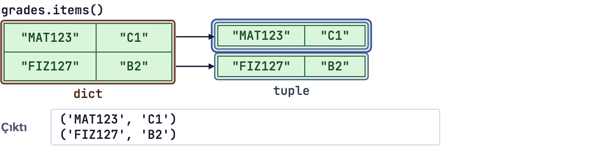
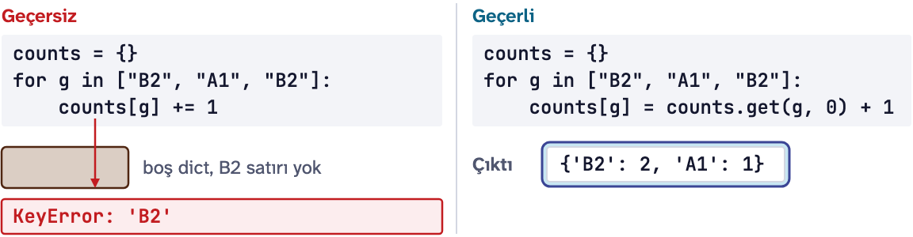
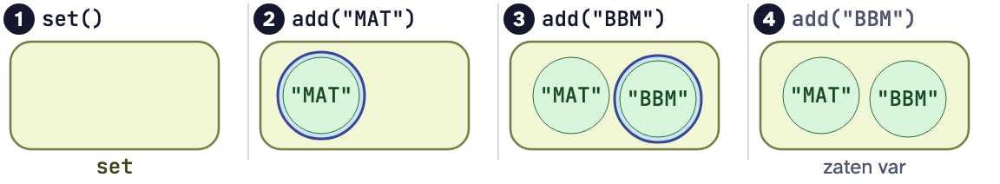
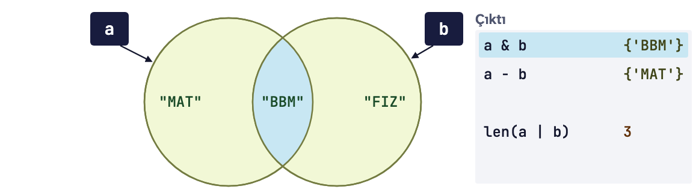
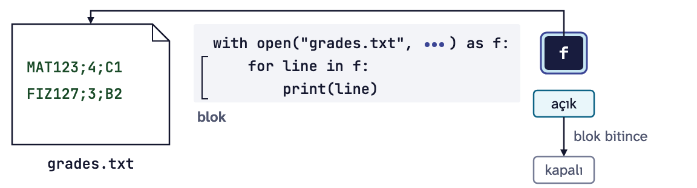
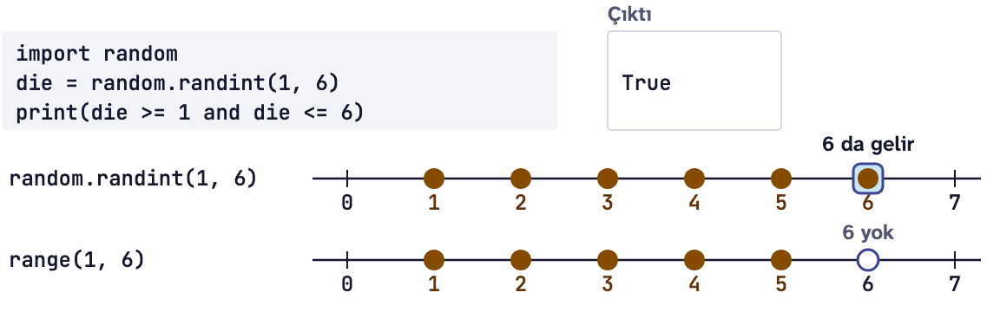

# Ödev 5: Kelime sayma

IEEE Hacettepe **Introduction to Python** dersinin 5. ödevi, Güz 2026.

<p align="center"></p>

Yukarıdaki kart bu haftanın özeti. Aşağıda aynı konuların daha ayrıntılı tekrarı var.

**İndirmek için:** yeşil **Code** düğmesine basın, **Download ZIP** deyin, zip'i açın. Git bilmenize gerek yok.

**Son teslim:** 22 Kasım 2026 Pazar, 23.59

**Teslim:** [Ödev 5 teslim formu](https://forms.gle/GoDQP1oTpEdeC2RD6)

Bu ödevin sonunda dict (sözlük) ve set (küme) ile sayabilecek, file'a (dosya) yazıp file'dan okuyabilecek ve ilk derste söz verdiğimiz kahve falı programını kendiniz yazmış olacaksınız.

## Bu ödevde kullanacaklarımız

### None
`None`, bir value'nun (değer) bilinmediğini gösterir. 0 değildir, boş bir str (karakter dizisi) de değildir. Type'ı (tip) `NoneType`'tır ve bu type'ın tek bir value'su vardır: `None`.

```python
market_value = None
print(market_value, type(market_value))   # None <class 'NoneType'>
```



Bir ismin `None`'ı gösterip göstermediğini `is None` ile sorarız. Kural kısa: value'ları `==` ile, `None`'ı `is None` ile kıyaslarız.

```python
market_value = None
print(market_value is None)   # True
print(market_value == 0)      # False
if market_value is None:
    print("Değeri bilinmiyor")   # Değeri bilinmiyor
```

`None` ile hesap yapılamaz. Python onu 0 saymaz, bir error message (hata mesajı) verir:

```python
print(150 + market_value)
```

```text
TypeError: unsupported operand type(s) for +: 'int' and 'NoneType'
```

Bir error message'ta `NoneType` görürseniz bir isim, beklemediğiniz bir yerde `None`'ı gösteriyor demektir.

### print, return ve None
`return` yazılmayan her function (fonksiyon) `None` döndürür. `print` değeri ekrana yazar; `return` ise değeri programa geri verir ve function'ı o anda bitirir.

```python
def print_square(x):
    print(x * x)


def square(x):
    return x * x


result = print_square(4)   # ekrana 16 yazar
print(result)              # None
print(square(4) + 1)       # 17
```

Function'ın sonucunu sonra kullanacaksanız function'ın içinde `print` değil `return` yazın. `print_square(4) + 1` önce ekrana 16 yazar, sonra `TypeError` verir, çünkü hesaba `None` girmiştir.

Aranan şey bulunamadığında `None` döndürmek Python'da sık görülen bir alışkanlıktır. Birazdan göreceğimiz `get()` da böyle yapar.

### dict ile tablo
dict, bilgiyi iki sütunlu bir tablo gibi çiftler halinde tutar: solda key (anahtar), sağda value. Kantindeki fiyat panosu gibidir: ürünün adı key, fiyatı value. Süslü parantezin içine `key: value` çiftleri yazılır, aralarına virgül konur. Value'ya, köşeli parantezin içine key'i yazarak ulaşırız.

```python
prices = {"çay": 15, "simit": 20, "tost": 70}
print(prices["tost"])   # 70
print(len(prices))      # 3
print(prices)           # {'çay': 15, 'simit': 20, 'tost': 70}
```



dict bir value'yu sırasıyla değil, key'iyle bulur. `prices[0]` yazarsanız Python 0 diye bir key arar, bulamaz ve `KeyError` verir.

| Yazdığınız | Ne olur |
|---|---|
| `prices = {}` | boş bir dict kurar |
| `prices["ayran"] = 25` | key yoksa dict'e yeni bir çift ekler |
| `prices["çay"] = 17` | key varsa eski value'nun üstüne yazar, ikinci bir satır açılmaz |
| `"çay" in prices` | key varsa `True` verir; `in` yalnızca key'lere bakar, value'lara bakmaz |
| `prices["kahve"]` | key yoksa `KeyError` verir |
| `prices.get("kahve", 0)` | key yoksa hata vermez, verdiğiniz ikinci değeri, burada `0`'ı döndürür |
| `prices.get("kahve")` | key yoksa ve ikinci değer verilmemişse `None` döndürür |

Zam gelince kantin ustası panoya yeni satır açmaz, eski fiyatın üstüne yazar. dict'te de her key yalnızca bir kez bulunur:

```python
prices = {"çay": 15}
prices["simit"] = 20   # yeni çift
prices["çay"] = 17     # zam: eski value'nun üstüne yazar
print(prices)          # {'çay': 17, 'simit': 20}
```

Büyük ve küçük harf ayrı key'ler sayılır. `"çay"` var ama `"Çay"` yok:

```python
print(prices["Çay"])
```

```text
KeyError: 'Çay'
```

Bir key'in olup olmadığından emin değilseniz önce `in` ile sorun ya da `get()` kullanın.

### dict üzerinde for ve items()
`for`, dict'in key'lerini eklendikleri sırayla verir. `items()` ise her çifti bir tuple (demet) olarak verir; tuple, Ders 4'teki gibi `for` satırında iki isme açılır.



```python
prices = {"çay": 17, "simit": 20}
for product in prices:
    print(product)

for product, price in prices.items():
    print(product, price, "TL")
```

```text
çay
simit
çay 17 TL
simit 20 TL
```

### Sayma kalıbı
Her sayım aynı kalıptır: değer ilk kez görülüyorsa 0'dan başla, sonra bir ekle. Sınıf başkanlığı seçimindeki tahta gibi düşünün: isim tahtada yoksa yazılır, sonra yanına çizik atılır.

```python
votes = ["Zehra", "Mehmet", "Zehra", "Ali", "Zehra"]
counts = {}
for name in votes:
    counts[name] = counts.get(name, 0) + 1
print(counts)   # {'Zehra': 3, 'Mehmet': 1, 'Ali': 1}
```



Satırı sağdan okuyun: `counts.get(name, 0)`, isim daha önce görülmediyse 0, görüldüyse eski sayıyı verir; soldaki assignment (atama) bir fazlasını yazar.

| Tur | `name` | `counts.get(name, 0)` | Turdan sonra `counts` |
|---|---|---|---|
| 1 | Zehra | 0 | `{'Zehra': 1}` |
| 2 | Mehmet | 0 | `{'Zehra': 1, 'Mehmet': 1}` |
| 3 | Zehra | 1 | `{'Zehra': 2, 'Mehmet': 1}` |
| 4 | Ali | 0 | `{'Zehra': 2, 'Mehmet': 1, 'Ali': 1}` |
| 5 | Zehra | 2 | `{'Zehra': 3, 'Mehmet': 1, 'Ali': 1}` |

En sık yapılan hata `counts[name] += 1` yazmaktır. `+=` önce eski sayıyı okumaya çalışır; ilk turda key henüz olmadığı için şu gelir:

```text
KeyError: 'Zehra'
```

### set
set her değeri bir kez tutar; sırası ve index'i (indis) yoktur. Gezdiğiniz illerin haritası gibidir: Ankara'ya on kez gitseniz de harita bir kez boyanır. Boş set `set()` ile kurulur, `add()` ile eleman eklenir. Eklenen değer zaten varsa `add()` set'i değiştirmez, hata da vermez.

```python
print(set([1, 2, 2, 3, 3, 3]))   # {1, 2, 3}

codes = ["MAT123", "BBM101", "BBM102"]
departments = set()
for code in codes:
    departments.add(code[:3])
print(len(departments), "BBM" in departments)   # 2 True
```



`code[:3]`, Ders 3'teki slicing (dilimleme): ders kodunun ilk üç harfi. BBM ikinci kez eklendiğinde set aynı kalır.

| Soru | list | set |
|---|---|---|
| Sırası korunur mu? | evet | hayır |
| index var mı? | evet | hayır |
| Aynı değer iki kez olur mu? | evet | hayır |
| Değiştirilebilir mi? | evet | evet |

Sıra ve tekrar önemliyse list'i, yalnızca "var mı?" sorusu önemliyse set'i seçin.

İki hata çok sık görülür. Birincisi `{}` yazmak: `{}` boş bir dict'tir, boş set `set()` ile yazılır. `{}` ile kurduğunuz şeye `add()` derseniz `AttributeError: 'dict' object has no attribute 'add'` gelir.

```python
print(type({}), type(set()))   # <class 'dict'> <class 'set'>
```

İkincisi index kullanmak: set'te index olmadığı için `s[0]` yazılamaz, `TypeError: 'set' object is not subscriptable` gelir.

Str'lerden oluşan bir set'i yazdırdığınızda sıra çalıştırmadan çalıştırmaya değişebilir. Bu yüzden aşağıdaki örneklerde çoğunlukla `len()` kullandık.

### &, - ve |
Bu üç operator (işlemci) iki set'ten yeni bir set yapar. İki arkadaşın gezdiği iller:

```python
mine = {"Ankara", "İzmir", "Van"}
friend = {"Ankara", "Trabzon"}
print(mine & friend)        # {'Ankara'}
print(len(mine | friend))   # 4
print(len(mine - friend))   # 2
print(len(friend - mine))   # 1
```



| Yazdığınız | Ne verir | Örnekte |
|---|---|---|
| `mine & friend` | ikisinde de olanlar | Ankara |
| `mine \| friend` | en az birinde olanların hepsi, her biri bir kez | Ankara, İzmir, Van, Trabzon |
| `mine - friend` | ilkinde olup ikincisinde olmayanlar | İzmir, Van |
| `friend - mine` | sıra değişince sonuç da değişir | Trabzon |

`mine` de `friend` de olduğu gibi kalır. Bu operator'lar yalnızca iki set arasında çalışır; biri list olursa `TypeError` gelir.

### File okuma
Program biter, memory (bellek) boşalır; file'a yazdığınız kalır. Bir file'ı okumak için `with open()` kullanırız. Girintili block bitince Python file'ı kendisi kapatır. `for`, file'ın satırlarını sırayla verir ve her satır bir str'dir.



Örneklerde `.py` dosyanızla aynı klasörde duran `menu.txt` adlı bir file var:

```text
çay;15
simit;20
tost;70
```

```python
with open("menu.txt", encoding="utf-8") as f:
    for line in f:
        print(line)
```

```text
çay;15

simit;20

tost;70

```

Her satırın sonunda görünmeyen bir satır sonu karakteri vardır: `\n`. `print` de kendi satır sonunu ekler; iki satır sonu bir boş satır eder. `strip()` satırın başındaki ve sonundaki boşlukları, `\n` dahil, siler.

| `line` | `len(line)` | `line.strip()` |
|---|---|---|
| `'çay;15\n'` | 7 | `'çay;15'` |
| `'simit;20\n'` | 9 | `'simit;20'` |

`split(";")` satırı noktalı virgüllerden böler. Parçalar her zaman str'dir; sayı gerekiyorsa `int()` ile çevirin.

```python
with open("menu.txt", encoding="utf-8") as f:
    for line in f:
        product, price = line.strip().split(";")
        print(product, int(price) * 2)
```

```text
çay 30
simit 40
tost 140
```

`int(price) * 2` yerine `price * 2` yazsaydınız ilk satır `çay 1515` olurdu: str iki kez yan yana yazılır. `strip()`'i unutursanız son parçanın sonunda `\n` kalır.

File açarken her seferinde `encoding="utf-8"` yazın. Yazmazsanız Python işletim sisteminin kodlamasını kullanır. Türkçe Windows'ta bu cp1254'tür ve UTF-8 kaydedilmiş bir file'daki `Büşra`, `Büşra` diye okunur. macOS'ta sorun görünmez, ama herkes aynı sonucu görsün diye her zaman yazıyoruz.

PyCharm'da Run ile çalışan program, adını yalın yazdığınız file'ı `.py` dosyanızın klasöründe arar; yazdığı file'lar da oraya gider.

### FileNotFoundError ve try
File yoksa, adı farklıysa ya da başka bir klasördeyse error message'ın son satırı şöyle olur:

```text
FileNotFoundError: [Errno 2] No such file or directory: 'menu.txt'
```

Ders 4'teki `try` burada da çalışır. `except FileNotFoundError:` bu exception'ı (sıra dışı durum) yakalar. Program traceback (yığın izi) verip durmaz, `except`'in altındaki satırlarla devam eder.

```python
try:
    with open("menu.txt", encoding="utf-8") as f:
        for line in f:
            print(line.strip())
except FileNotFoundError:
    print("Menü henüz asılmamış.")
print("Program devam ediyor.")
```

`menu.txt` yokken çıktı:

```text
Menü henüz asılmamış.
Program devam ediyor.
```

### File'a yazma: "w" ve "a"
`open()`'ın ikinci argument'ı (argüman) file'ın hangi modda açılacağını söyler.

| Mod | Ne yapar | File yoksa |
|---|---|---|
| `"r"` (hiçbir şey yazmazsanız bu) | okur | `FileNotFoundError` verir |
| `"w"` | önce içini boşaltır, sonra yazar | oluşturur |
| `"a"` | yazılanı sonuna ekler, eski satırlar yerinde kalır | oluşturur |

Kısaca r sayfayı okur, w sayfayı yırtıp baştan yazar, a kaldığı satırdan sürer.

`write()` file'a yazar, ekrana hiçbir şey yazmaz. Satır sonu da eklemez; `\n`'i kendiniz yazarsınız:

```python
with open("log.txt", "w", encoding="utf-8") as f:
    f.write("spam")
    f.write("eggs\n")
    f.write("ham\n")

with open("log.txt", encoding="utf-8") as f:
    for line in f:
        print(line.strip())
```

```text
spameggs
ham
```

İlk iki yazı birleşti, çünkü `"spam"`'in sonunda `\n` yok.

`"a"` ile açan program, her çalıştığında file'ın sonuna ekler:

```python
with open("visits.txt", "a", encoding="utf-8") as f:
    f.write("Zehra uğradı\n")
```

Bu programı üç kez çalıştırırsanız `visits.txt`'de üç satır olur. Aynı programda `"a"` yerine `"w"` yazsaydınız her seferinde tek satır kalırdı.

| | `print()` | `f.write()` |
|---|---|---|
| Nereye yazar | Run penceresine | file'a |
| Satır sonu | kendisi ekler | eklemez, `"\n"`'i siz yazarsınız |
| Ne alır | her type | yalnızca str |

`write()`'a sayı verirseniz `TypeError: write() argument must be str, not int` gelir. Sayıyı f-string ile yazın: `f.write(f"Fiyat: {price}\n")`.

Okumak istediğiniz bir file'ı asla `"w"` ile açmayın: `open()` satırı çalıştığı anda içi silinir ve Python sormaz.

Yazılan file PyCharm'ın Project penceresinde görünmezse **File**, **Reload All from Disk** deyin.

### turtle komutları
Görev 5'te fincanı turtle çiziyor. turtle, Python'la gelen bir module (modül). Pencerenin ortası (0, 0) noktasıdır: x büyüdükçe sağa, y büyüdükçe yukarı gidilir. Fincanı çizen kısım hazır; sizin yazacağınız komutlar `goto()`, `dot()` ve `done()`.

| Komut | Ne yapar |
|---|---|
| `turtle.speed(0)` | en hızlı çizim |
| `turtle.penup()` | kalemi kaldırır, iz bırakmadan gider |
| `turtle.pendown()` | kalemi indirir, giderken çizer |
| `turtle.goto(x, y)` | (x, y) noktasına gider |
| `turtle.circle(150)` | 150 yarıçaplı bir çember çizer |
| `turtle.dot(8, "brown")` | bulunduğu yere 8 piksellik kahverengi bir nokta koyar |
| `turtle.hideturtle()` | oku gizler |
| `turtle.done()` | pencereyi siz kapatana kadar açık tutar |

```python
import turtle

turtle.speed(0)
turtle.hideturtle()
turtle.penup()
turtle.goto(-60, 0)
turtle.dot(30, "red")
turtle.goto(60, 0)
turtle.dot(30, "blue")
turtle.done()
```

Pencerede solda kırmızı, sağda mavi iki nokta görünür. Kalem kalkık olduğu için aralarında çizgi yok.

Klasörünüzdeki bir dosyaya `turtle.py` ya da `random.py` adını vermeyin: `import` önce kendi klasörünüze bakar ve Python'un module'ü yerine sizin dosyanızı getirir.

### random.randint()
Ders 4'ten: `random.randint(a, b)`, a ile b arasında rastgele bir tam sayı verir ve iki uç da gelebilir. Tavla zarı gibi: 6 da gelir, yoksa düşeş hiç olmazdı.

```python
import random

die = random.randint(1, 6)
print(die >= 1 and die <= 6)   # True
```



Çıktıda belli bir sayı yerine `True` var, çünkü zar her çalıştırmada başka gelir.

| Yazdığınız | Gelebilecek sayılar |
|---|---|
| `random.randint(1, 6)` | 1, 2, 3, 4, 5, 6 |
| `range(1, 6)` | 1, 2, 3, 4, 5 (6 yok) |
| `random.randint(-2, 2)` | -2, -1, 0, 1, 2 |

### Önceki derslerden
Görevlerde bunlar da geçiyor:

| Yapı | Ders | Hatırlatma |
|---|---|---|
| `**` | Ders 1 | üs alma: `3 ** 2` sonucu `9` |
| `lower()`, `strip()` | Ders 2 | `" Zehra\n".strip().lower()` sonucu `'zehra'` |
| f-string | Ders 2 | `f"{product}: {price} TL"`, product `"çay"` ve price `15` iken `'çay: 15 TL'` |
| `if`, `elif`, `else`, `and` | Ders 2 | `and`, iki şart da `True` ise `True` verir |
| `while` ve sayaç | Ders 3 | devam şartı `True` oldukça döner; sayacı artırmayı unutursanız loop (döngü) hiç bitmez |
| `+=` | Ders 3 | `n += 1`, `n = n + 1` demektir |
| index ve `len()` | Ders 3 | `word = "kahve"` iken `word[0]` sonucu `'k'`, `len(word)` sonucu `5` |
| `for i in range(len(word)):` | Ders 3 | bir str'i index ile harf harf dolaşır; her turda `word[i]` bir harftir |
| `split()` | Ders 4 | `"çay simit tost".split()` sonucu `['çay', 'simit', 'tost']` |
| `def` ve `return` | Ders 4 | `return`, loop'un içinde de function'ı o anda bitirir |
| tuple ve unpacking | Ders 4 | `for product, price in [("çay", 15), ("simit", 20)]:` her tuple'ı iki isme açar |
| `try` ve `except` | Ders 4 | `except`'ten sonra adı yazılan exception'ı yakalar |

## Görevler

Görevlerin ayrıntısı ve her birinin beklenen çıktısı `odev5.py` dosyasının içinde.

1. **Dersi bul:** Aranan ders transkriptte varsa kredisini, yoksa `None` return eden `find_credits()` function'ını yazacak, sonucu `is None` ile sınayacaksınız.
2. **Kelime sayma:** Bir tekerlemedeki kelimeleri sayma kalıbıyla bir dict'te sayacak, birden çok geçenleri `items()` ile yazdıracaksınız.
3. **Alfabenin harfleri:** Bir cümlenin harflerini `add()` ile bir set'e toplayan `letters_of()` function'ını yazacak; eksik, ortak ve toplam harfleri `-`, `&` ve `|` ile sayacaksınız.
4. **Not dökümü dosyası:** `transcript.txt`'yi `"w"` ile yazacak, sonra satır satır okuyup her dersin son notunu bir dict'e koyacaksınız. File yoksa `FileNotFoundError`'ı yakalayacaksınız.
5. **Kahve falı:** Hazır gelen fincanın içine turtle ile 100 telve noktası serpecek, her çeyrekteki noktaları bir dict'te sayacak, en kalabalık çeyreğin falını yazdırıp `"a"` ile `fal.txt`'nin sonuna ekleyeceksiniz.

Zorunlu olmayan bir **Meraklısına** görevi de var: `fal.txt`'yi okuyup kaç fala ve kaç farklı kişiye bakıldığını bir set ile saymak.

Sadece Ders 1-5'te gördüğümüz yapıları kullanın.

## Nasıl çalışılır

1. Zip'ten çıkan `odev5.py` ve `kontrol.py` dosyalarını aynı klasörde tutun ve `odev5.py`'yi PyCharm'da açın.
2. Her görevde `# TODO` satırının yerine kodunuzu yazın.
3. Görev 1, 3, 4 ve 5'te test satırları comment olarak duruyor. Kodunuzu yazdıktan sonra bu satırları seçin ve Ctrl+/ (macOS: Cmd+/) ile açın.
4. Dosyayı **Run** ile çalıştırın ve çıktıyı görevin "Beklenen çıktı" kısmıyla karşılaştırın. Görev 5 Run penceresinde adınızı sorar; yazıp Enter'a basın. Fincan ayrı bir pencerede çizilir, o pencereyi kapatınca program biter.
5. Program `odev5.py`'nin yanına `transcript.txt` ve `fal.txt` yazar. Project penceresinde görünmezlerse **File**, **Reload All from Disk** deyin.

## Kendi kendinize kontrol

Bitirince `kontrol.py`'yi PyCharm'da açıp **Run** deyin. Her görev için geçti ya da kaldı yazar, kaldıysa beklenen satırı ve sizin satırınızı ya da eksik olanı gösterir. Kontrol not vermez, sadece size yol gösterir.

`kontrol.py`, `odev5.py`'yi geçici bir klasörde çalıştırır ve Görev 5'te ad olarak Mehmet yazar. Fincan penceresi açılmaz, kontrol turtle'ın koyduğu noktaları sayar. Telve her çalıştırmada başka yere düştüğü için Görev 5'te satırların biçimine ve yazdığınız sayının fincandaki noktalarla tutup tutmadığına bakar. Function'larınızı test satırlarındakinden başka değerlerle de dener. Sizin `transcript.txt` ve `fal.txt` dosyalarınıza dokunmaz.

## Teslim

[Ödev 5 teslim formunda](https://forms.gle/GoDQP1oTpEdeC2RD6) "İsim" alanına isminizi yazın, `odev5.py`'yi "Ödev dosyası" alanına yükleyin ve onay kutusunu işaretleyin.

Takıldığınız bir yer olursa dersin WhatsApp grubuna yazın.

Dersin sitesi: https://natozenbilek.github.io/ieee-hacettepe-python-course/
